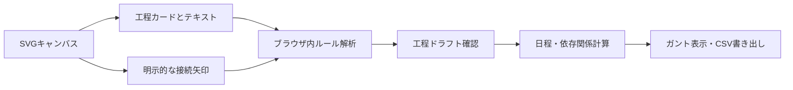

# Architecture | no-API local scheduling

## データフロー

- **外部API・AIなし。** 解析用のHTTP通信も認証キー管理も不要。
- 解析対象は工程カードと日数が明示されたテキスト。手書き線や付箋は注釈として保持するが、自動工程変換しない。
- 未指定の工期は暫定1日、`needsReview` として扱う。明示的な矢印だけを依存関係に変換する。
- キャンバス操作と日程生成を分離し、工期・担当者・開始日・依存関係は生成後にユーザーが修正できる。
- 工程間の循環依存は接続時に拒否し、スケジューラーでも警告する。
- 計算は暦日。休日、天候、資材搬入、職人の重複リソースは今回未対応。
- `localStorage` でブラウザ内に自動保存。デバイス間同期はない。JSONバックアップを推奨。

## 受け入れ条件

1. APIキーを設定せず `npm run dev` から利用できる。
2. `工程表を生成` を押した際、ブラウザから外部解析エンドポイントへの通信が発生しない。
3. 工程カード4件＋矢印3本を含むサンプルが工程ドラフトとガントチャートになる。
4. 接続矢印のドラッグ、カード移動時の追従、循環参照拒否が動作する。
5. 自由描画は残し、手書き文字認識を提供していると誤解させない。
6. CSV/JSON/PNG/SVG書き出しと編集・Undo/Redoが壊れない。
