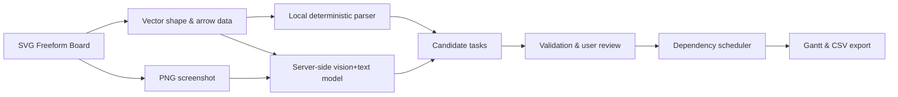

# Architecture and product boundaries

## Objective

Convert unstructured construction planning ideas into an editable draft. Freeform planning is the input surface, **not** the source of truth for final dates. Human review is mandatory because construction tasks can have safety and cost implications.

### AI boundary

- Browser data: task cards, text, sticky notes, pen strokes, explicit dependency arrows.
- Handwriting: nearby pen strokes become deterministic `ink_...` regions. The AI is given region coordinates plus the canvas image; recognition is experimental and can fail. It is never presented as reliable OCR without evaluation.
- API endpoint: `api/analyze.js` receives the image and normalized vector metadata; the model returns structured task fields. User-supplied canvas text is untrusted input, never system instructions.
- Validation: source IDs must exist in submitted objects. AI-inferred dependencies (without an explicit arrow) are flagged for review; dates and durations are not silently confirmed.
- Local fallback: not AI. Only task-card text, duration labels, and arrow relationships are parsed.

### Date semantics

- All date calculations currently use calendar days (including weekends).
- A successor begins the following day after its latest predecessor ends.
- Explicit start dates can delay but not supersede a dependency. Conflicts are reported.
- Resource leveling, public holidays, subcontractor availability, work shifts, rainy days, and CPM are **future scope**.

## MVP acceptance checks

- Drawing and movement works on desktop browser.
- At least four sample cards generate an editable Gantt, respecting three arrows.
- Deleting a connected card also deletes its edges.
- No AI key produces a visibly labeled rule-based result, not a misleading AI success state.
- Data exports to JSON and CSV; PNG and SVG downloads work.
- Invalid AI source IDs cannot create tasks.
- No API key appears in client-side code or repository.

## Suggested follow-up validation (targets, not claims)

1. Run usability tests with five site managers to check whether free drawing reduces input friction.
2. Gather 30 consenting handwritten examples, label actual tasks/durations/dependencies, report precision, recall, and missing-source rate.
3. Test inferred dependency acceptance/rejection rate before allowing any automatic date propagation.
4. Add auth, durable quota/rate limits, database and audit logging before inviting external customers.
